# Design — US-03 Detectar preguntas sin respuesta (`aud_detect_gaps`)

## 1. Resumen

Esta especificación diseña la primera fase del pipeline de análisis de IA de AuditBot AI: la detección, clasificación, agrupación y persistencia de brechas de conocimiento (knowledge gaps) en conversaciones que fueron previamente admitidas por el consumidor AMQP (US-02).

El componente se activa a través del puerto de extensión `IAuditPipelineTrigger`, extrayendo los turnos de diálogo entre usuario y asistente. Invoca un adaptador de integración `OpenAiKnowledgeGapAdapter` que consume la compatibilidad OpenAI de Ollama mediante `ChatClient` de Spring AI. Los hallazgos clasificados pasan a un analizador de dominio puro (`KnowledgeGapAnalyzer`), libre de frameworks, que descarta candidatos bajo el umbral de confianza y agrupa paráfrasis mediante similitud de conjuntos Jaccard. Finalmente, un servicio transaccional (`KnowledgeGapServiceImpl`) persiste los gaps consolidados en la tabla `audit_gap`, actualiza el contador `gaps_count` y la fecha de actualización en `audit_result`, y mantiene el estado en `PROCESSING` para las siguientes fases (US-04 a US-06).

---

## 2. Diagrama de flujo y arquitectura por capas

```mermaid
flowchart TD
    A["RabbitMQ Listener / ConversationAuditIntakeServiceImpl"]
    B["IAuditPipelineTrigger.trigger(chatId, conversation)<br/>[service]"]
    C["AuditPipelineOrchestratorImpl<br/>[service.impl]"]
    D["IKnowledgeGapService.analyzeAndPersistGaps(chatId, conv)<br/>[service]"]
    E["KnowledgeGapServiceImpl.analyzeAndPersistGaps(...)<br/>[service.impl] @Transactional"]

    A -->|"chatId admitido y persistido en estado PROCESSING"| B
    B --> C
    C -->|"delega la etapa de detección de gaps"| D
    D --> E

    E --> F["1. Reconstrucción de turnos<br/>USER → ASSISTANT<br/>dto.ConversationTurnDto"]

    F --> G["2. Clasificación asistida por IA<br/>IKnowledgeGapAiClient.classifyTurns(turns)<br/>[integration.openai]"]

    G --> H["OpenAiKnowledgeGapAdapter<br/>(Spring AI ChatClient)"]
    H -->|"HTTP POST /v1/chat/completions (Ollama)"| I["Ollama"]
    I -->|"JSON estructurado con GapAnalysisResponseDto"| J["3. Agrupación y consolidación de gaps<br/>(Lógica Pura)"]

    J --> K["KnowledgeGapAnalyzer.groupAndConsolidate(candidates, minConf, simThreshold)<br/>[analyzer]"]

    K --> L["a. Filtrado de confidenceScore < min-confidence"]
    L --> M["b. Normalización<br/>(minúsculas, diacríticos, puntuación)"]
    M --> N["c. Tokenización y remoción de stopwords"]
    N --> O["d. Similitud Jaccard intra-conversación >= 0.70"]
    O --> P["e. Selección de pregunta canónica y primer messageId cronológico"]

    P --> Q["4. Persistencia relacional"]

    Q --> R["IAuditGapRepository.deleteByAuditResult_AuditId(auditId)<br/>[si retry]"]
    R --> S["IAuditGapRepository.saveAll(auditGaps)<br/>[repository]"]

    S --> T["5. Actualización de auditoría raíz"]
    T --> U["IAuditResultRepository:<br/>gapsCount, updatedDate, status=PROCESSING"]

    U --> V["Fin de etapa<br/>Emisión de log estructurado<br/>etapa=GAP_DETECTION"]
```



### Frontera de cada capa

| Capa | Paquete | Qué PUEDE hacer | Qué NO PUEDE hacer |
|---|---|---|---|
| **Integración OpenAI** | `api.integration.openai` | Usar Spring AI (`ChatClient`, `ChatClient.Builder`), configurar prompts, invocar el endpoint OpenAI/Ollama, parsear JSON estructurado. | Importar entidades JPA, repositorios, o contener lógica de similitud o negocio. |
| **Analizador Puro** | `api.analyzer` | Lógica pura de normalización, tokenización, cálculo de coeficientes de similitud Jaccard, agrupación de paráfrasis. | Depender de Spring (`@Component`, etc.), Spring AI, JPA, Jackson o AMQP. |
| **Servicio de Aplicación** | `api.service`, `api.service.impl` | Orquestar el flujo, transformar DTOs a entidades, gestionar transacciones (`@Transactional`), manejar excepciones y timeouts. | Invocar librerías externas directamente sin pasar por puertos de integración. |
| **Repositorio / Modelo** | `api.repository`, `api.model` | Mapeo relacional JPA de `AuditGap`, consultas Spring Data JPA. | Contener lógica de análisis o dependencias de Spring AI. |

---

## 3. Decisiones técnicas y alternativas descartadas

### Decisión 1: Spring AI OpenAI Starter frente a Ollama Starter nativo
- **Elección:** Usar `spring-ai-starter-model-openai` apuntando `spring.ai.openai.chat.base-url` a `http://localhost:11434/v1`.
- **Justificación:** Ollama expone compatibilidad completa con la especificación OpenAI (`/v1/chat/completions`). Usar el starter de OpenAI ofrece mayor interoperabilidad y estandarización de la industria, permitiendo alternar entre Ollama local, Ollama en la nube u otros proveedores (OpenAI, DeepSeek, vLLM) sin modificar una sola línea de código Java.
- **Alternativa descartada:** Starter nativo `spring-ai-starter-model-ollama`. Descartado porque acopla la aplicación a la API propietaria de Ollama e introduce dependencias adicionales innecesarias en el `pom.xml`.

### Decisión 2: Similitud léxica Jaccard intra-conversación frente a Embeddings vectoriales
- **Elección:** Algoritmo determinista de tokenización con similitud de conjuntos Jaccard sobre turnos de la misma conversación en memoria.
- **Justificación:** Dentro de una única conversación (típicamente 10 a 50 mensajes), las reiteraciones de un usuario corresponden a reformulaciones léxicamente muy próximas ("¿tienen envíos a domicilio?" vs "hacen entregas a casa?"). Jaccard sobre n-gramas/tokens normalizados sin stopwords resuelve la deduplicación en menos de 5 ms sin requerir modelos de embeddings, servicios vectoriales externos (pgvector/Pinecone) ni latencia adicional.
- **Alternativa descartada:** Base de datos vectorial con embeddings (ej. `nomic-embed-text`). Descartada por sobredimensionamiento arquitectónico y sobrecosto de latencia innecesario para agrupación intra-sesión en el alcance actual.

### Decisión 3: Paso de contexto de conversación en memoria vía `IAuditPipelineTrigger`
- **Elección:** Refinar `IAuditPipelineTrigger.trigger(String chatId, AuditConversationDto conversation)`.
- **Justificación:** La tabla `audit_result` no almacena el texto completo de los mensajes por privacidad. El pipeline requiere los textos de los mensajes en memoria durante el procesamiento de la admisión AMQP. Pasar el DTO validado desacopla la persistencia de control del análisis en vuelo.
- **Alternativa descartada:** Persistir temporalmente todos los mensajes en una tabla `audit_message`. Descartada para evitar consumo masivo de almacenamiento y exposición innecesaria de PII.

---

## 4. Componentes, puertos y adaptadores

### 4.1 Paquete DTO (`ec.com.technoloqie.auditbot.api.dto`)

#### `ConversationTurnDto` (Record)
```java
public record ConversationTurnDto(
    String userMessageId,
    String userQuestion,
    String assistantMessageId,
    String assistantResponse
) {}
```

#### `KnowledgeGapCandidateDto` (Record)
```java
public record KnowledgeGapCandidateDto(
    String messageId,
    String questionText,
    boolean isGap,
    BigDecimal confidenceScore,
    String reason
) {}
```

#### `GapAnalysisResponseDto` (Record)
```java
public record GapAnalysisResponseDto(
    List<KnowledgeGapCandidateDto> classifications
) {}
```

#### `KnowledgeGapItemDto` (Record)
```java
public record KnowledgeGapItemDto(
    String messageId,
    String questionText,
    BigDecimal confidenceScore,
    int occurrencesCount
) {}
```

### 4.2 Puerto y Adaptador de Integración OpenAI (`ec.com.technoloqie.auditbot.api.integration.openai`)

#### Puerto: `IKnowledgeGapAiClient`
```java
public interface IKnowledgeGapAiClient {
    GapAnalysisResponseDto classifyTurns(List<ConversationTurnDto> turns);
}
```

#### Adaptador: `OpenAiKnowledgeGapAdapter`
```java
@Component
public class OpenAiKnowledgeGapAdapter implements IKnowledgeGapAiClient {

    private final ChatClient chatClient;
    private final Duration timeout;

    public OpenAiKnowledgeGapAdapter(
            ChatClient.Builder builder,
            @Value("${auditbot.ai.openai.timeout-seconds:30}") long timeoutSeconds) {
        this.chatClient = builder
                .defaultSystem(SYSTEM_PROMPT)
                .build();
        this.timeout = Duration.ofSeconds(timeoutSeconds);
    }

    @Override
    public GapAnalysisResponseDto classifyTurns(List<ConversationTurnDto> turns) {
        // Ejecución con timeout y parseo a GapAnalysisResponseDto
    }
}
```

### 4.3 Analizador Puro (`ec.com.technoloqie.auditbot.api.analyzer`)

#### `KnowledgeGapAnalyzer`
```java
public class KnowledgeGapAnalyzer {

    public List<KnowledgeGapItemDto> groupAndConsolidate(
            List<KnowledgeGapCandidateDto> candidates,
            BigDecimal minConfidence,
            double similarityThreshold) {
        // 1. Filtrar candidates con isGap == true y confidenceScore >= minConfidence
        // 2. Para cada candidato: normalizar y tokenizar
        // 3. Agrupar si Jaccard >= similarityThreshold
        // 4. Seleccionar primer messageId y pregunta con mayor longitud/tokens
        // 5. Retornar lista de KnowledgeGapItemDto consolidados
    }

    public double calculateJaccardSimilarity(String textA, String textB) { ... }
    public String normalize(String text) { ... }
    public Set<String> tokenizeAndFilterStopwords(String text) { ... }
}
```

### 4.4 Orquestador y Servicio (`ec.com.technoloqie.auditbot.api.service`)

#### `IAuditPipelineTrigger`
```java
public interface IAuditPipelineTrigger {
    void trigger(String chatId, AuditConversationDto conversation);
}
```

#### `IKnowledgeGapService`
```java
public interface IKnowledgeGapService {
    void analyzeAndPersistGaps(String chatId, AuditConversationDto conversation);
}
```

#### `KnowledgeGapServiceImpl`
- Inyecta `IKnowledgeGapAiClient`, `KnowledgeGapAnalyzer`, `IAuditResultRepository`, `IAuditGapRepository`, `Clock`.
- Coordina la extracción de turnos, llamada al cliente, agrupación pura, persistencia en `audit_gap`, actualización de `audit_result` y emisión de logs estructurados.

---

## 5. Algoritmo y Prompt Engineering

### 5.1 System Prompt para Detección de Gaps
```text
Eres un auditor experto de conversaciones de atención al cliente y soporte.
Tu misión es analizar si las consultas del usuario fueron respondidas con éxito o si revelan una brecha de conocimiento (knowledge gap) del asistente virtual.

Una respuesta constituye un gap de conocimiento si el asistente:
1) Admite explícitamente no saber o no contar con la información solicitada.
2) Proporciona respuestas evasivas, genéricas o fuera del contexto de la pregunta.
3) Pide disculpas reiteradas sin ofrecer una solución o canal de resolución.
4) No cubre el objetivo central de la consulta del usuario.

Devuelve estrictamente un objeto JSON con la clave "classifications" que contenga un arreglo con el análisis de cada turno:
- "messageId": identificador del mensaje del usuario analizado
- "questionText": texto original de la pregunta del usuario
- "isGap": booleano (true si es brecha de conocimiento, false en caso contrario)
- "confidenceScore": número decimal entre 0.000 y 1.000 indicando tu grado de certeza
- "reason": breve justificación técnica de la clasificación
```

### 5.2 Algoritmo de Deduplicación Jaccard en `KnowledgeGapAnalyzer`
1. **Normalización:**
   - `text.toLowerCase(Locale.ROOT)`
   - Reemplazo de tildes: `á→a`, `é→e`, `í→i`, `ó→o`, `ú→u`, `ñ→n`.
   - Eliminación de puntuación: `[^a-z0-9\\s]`.
2. **Tokenización y Stopwords:**
   - División por espacios en blanco `\\s+`.
   - Filtrado contra conjunto inmutable de stopwords en español (`el`, `la`, `los`, `las`, `un`, `una`, `de`, `del`, `a`, `en`, `para`, `por`, `con`, `que`, `es`, `son`, `como`, `y`, `o`).
3. **Cálculo Jaccard:**
   $$J(S_1, S_2) = \frac{|S_1 \cap S_2|}{|S_1 \cup S_2|}$$
   Si ambos conjuntos están vacíos, similitud es `1.0` si los textos originales coinciden, o `0.0` si difieren.
4. **Agrupamiento Greedy Determinista:**
   - Se itera sobre los candidatos en orden cronológico.
   - Si un candidato tiene $J \ge \text{threshold}$ con el líder de un grupo existente, se anexa a dicho grupo.
   - Si no, funda un nuevo grupo.

---

## 6. Modelo de datos y migración

### Script Flyway: `src/main/resources/db/migration/V2__create_audit_gap.sql`

```sql
-- V2__create_audit_gap.sql
-- Creación de la tabla de gaps de conocimiento detectados (US-03)

CREATE TABLE audit_gap (
    gap_id           CHAR(36)        NOT NULL,
    audit_id         CHAR(36)        NOT NULL,
    message_id       VARCHAR(128)    NOT NULL,
    question_text    TEXT            NOT NULL,
    confidence_score DECIMAL(4,3)    NOT NULL,
    created_date     DATETIME(6)     NOT NULL,

    CONSTRAINT pk_audit_gap PRIMARY KEY (gap_id),
    CONSTRAINT fk_audit_gap_audit_result 
        FOREIGN KEY (audit_id) REFERENCES audit_result (audit_id) 
        ON DELETE CASCADE
);

CREATE INDEX idx_audit_gap_audit_id ON audit_gap (audit_id);
```

### Entidad JPA: `AuditGap.java`

- Tabla: `audit_gap`.
- Clave primaria: `gap_id` (String de 36 caracteres, asignado mediante UUID v4).
- Relación: `@ManyToOne(fetch = FetchType.LAZY, optional = false)`, `@JoinColumn(name = "audit_id")`.
- `message_id`: `@Column(name = "message_id", nullable = false, length = 128)`.
- `question_text`: `@Column(name = "question_text", nullable = false, columnDefinition = "TEXT")`.
- `confidence_score`: `@Column(name = "confidence_score", nullable = false, precision = 4, scale = 3)`.
- `created_date`: `@Column(name = "created_date", nullable = false)`.

---

## 7. Propiedades y configuración

```properties
# Spring AI - OpenAI / Ollama compatible configuration
spring.ai.openai.api-key=${OLLAMA_API_KEY:ollama}
spring.ai.openai.chat.base-url=${OLLAMA_BASE_URL:http://localhost:11434/v1}
spring.ai.openai.chat.options.model=${OLLAMA_MODEL:deepseek-v4.1-flash}
spring.ai.openai.chat.options.temperature=0.7

# Gaps analysis tuning
auditbot.ai.openai.timeout-seconds=30
auditbot.ai.gaps.min-confidence=0.60
auditbot.ai.gaps.similarity-threshold=0.70
```

---

## 8. Resiliencia, observabilidad y trazabilidad

### Manejo de Fallos
- Si la llamada al cliente LLM lanza una excepción (timeout, HTTP 5xx, JSON ilegible):
  1. Se captura la excepción en `KnowledgeGapServiceImpl`.
  2. No se insertan registros en `audit_gap`.
  3. Se carga `AuditResult` por `chatId`, se actualiza `status = AuditStatus.FAILED` y `errorMessage` con la descripción del error acotada a 500 caracteres sin incluir PII.
  4. Se registra el error con log structured: `resultado=FAILED`.

### Log Estructurado
```text
etapa=GAP_DETECTION chatId=chat-101 assistantId=asst-1 gapsDetectados=2 mensajesAnalizados=14 duracionMs=342 resultado=OK
```
