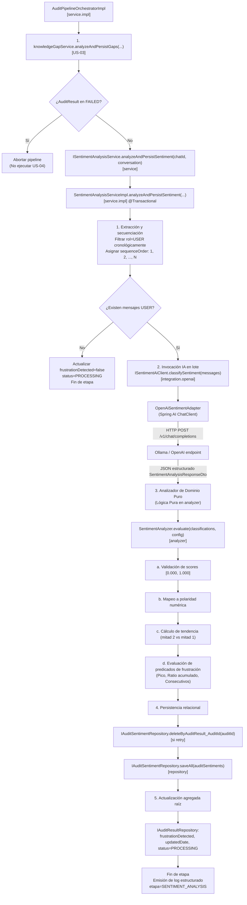

# Design — US-04 Detectar frustración del usuario (`aud_sentiment_analisys`)

## 1. Resumen

Esta especificación diseña la segunda fase del pipeline de análisis de IA de AuditBot AI: la clasificación de sentimientos de los mensajes emitidos por el usuario, el cálculo de la tendencia emocional durante la conversación y la determinación de la bandera de frustración (`frustration_detected`).

El componente es activado secuencialmente por `AuditPipelineOrchestratorImpl` tras la culminación exitosa de la detección de gaps (US-03). Extrae los mensajes con rol `USER` en estricto orden cronológico, invoca un adaptador de integración (`OpenAiSentimentAdapter`) que envía el lote de mensajes a la API compatible OpenAI / Ollama (`/v1`) mediante `ChatClient` de Spring AI con structured output JSON. Los resultados estructurados son evaluados por un analizador de dominio puro (`SentimentAnalyzer`), libre de frameworks, que calcula la tendencia emocional (`IMPROVING`, `WORSENING`, `STABLE`) y dictamina si se activan las condiciones de frustración (pico individual, ratio de negatividad, negativos consecutivos). Finalmente, el servicio de aplicación transaccional (`SentimentAnalysisServiceImpl`) persiste los registros en la tabla `audit_sentiment`, actualiza `frustration_detected` y `updated_date` en `audit_result`, y mantiene el estado en `PROCESSING` para las etapas subsecuentes (US-05 y US-06).

---

## 2. Diagrama de flujo y arquitectura por capas



### Frontera de cada capa

| Capa | Paquete | Qué PUEDE hacer | Qué NO PUEDE hacer |
|---|---|---|---|
| **Integración OpenAI** | `api.integration.openai` | Usar Spring AI (`ChatClient`, `ChatClient.Builder`), configurar prompts, invocar el endpoint compatible OpenAI/Ollama, parsear JSON estructurado. | Importar entidades JPA, repositorios, o contener lógica de umbrales y reglas de negocio. |
| **Analizador Puro** | `api.analyzer` | Lógica pura de cálculo de tendencia, polaridad numérica, cómputo de ratios y evaluación de predicados de frustración. | Depender de Spring (`@Component`, etc.), Spring AI, JPA, Jackson o AMQP. |
| **Servicio de Aplicación** | `api.service`, `api.service.impl` | Orquestar el flujo, transformar DTOs a entidades, gestionar transacciones (`@Transactional`), manejar excepciones y timeouts. | Invocar librerías externas directamente sin pasar por puertos de integración. |
| **Repositorio / Modelo** | `api.repository`, `api.model` | Mapeo relacional JPA de `AuditSentiment`, enums de dominio, consultas Spring Data JPA. | Contener lógica de análisis o dependencias de Spring AI. |

---

## 3. Firmas de clases, interfaces y métodos

### 3.1 DTOs y Enums (`ec.com.technoloqie.auditbot.api.model` y `.dto`)

```java
package ec.com.technoloqie.auditbot.api.model;

public enum SentimentLabel {
    POSITIVE,
    NEUTRAL,
    NEGATIVE,
    FRUSTRATED
}
```

```java
package ec.com.technoloqie.auditbot.api.model;

public enum SentimentTrend {
    IMPROVING,
    WORSENING,
    STABLE
}
```

```java
package ec.com.technoloqie.auditbot.api.dto;

import ec.com.technoloqie.auditbot.api.model.SentimentLabel;
import java.math.BigDecimal;

public record SentimentItemClassificationDto(
        String messageId,
        SentimentLabel label,
        BigDecimal score) {}
```

```java
package ec.com.technoloqie.auditbot.api.dto;

import java.util.List;

public record SentimentAnalysisResponseDto(
        List<SentimentItemClassificationDto> classifications) {
    public SentimentAnalysisResponseDto {
        classifications = classifications == null ? List.of() : List.copyOf(classifications);
    }
}
```

```java
package ec.com.technoloqie.auditbot.api.dto;

import ec.com.technoloqie.auditbot.api.model.SentimentLabel;
import ec.com.technoloqie.auditbot.api.model.SentimentTrend;
import java.math.BigDecimal;
import java.util.List;

public record SentimentEvaluationResultDto(
        List<ProcessedSentimentDto> items,
        boolean frustrationDetected,
        SentimentTrend trend) {}
```

```java
package ec.com.technoloqie.auditbot.api.dto;

import ec.com.technoloqie.auditbot.api.model.SentimentLabel;
import java.math.BigDecimal;

public record ProcessedSentimentDto(
        String messageId,
        SentimentLabel label,
        BigDecimal score,
        int sequenceOrder) {}
```

### 3.2 Puerto y Adaptador de Integración (`api.integration.openai`)

```java
package ec.com.technoloqie.auditbot.api.integration.openai;

import ec.com.technoloqie.auditbot.api.dto.AuditMessageDto;
import ec.com.technoloqie.auditbot.api.dto.SentimentAnalysisResponseDto;
import java.util.List;

public interface ISentimentAiClient {
    SentimentAnalysisResponseDto classifySentiment(List<AuditMessageDto> userMessages);
}
```

```java
package ec.com.technoloqie.auditbot.api.integration.openai;

import ec.com.technoloqie.auditbot.api.dto.AuditMessageDto;
import ec.com.technoloqie.auditbot.api.dto.SentimentAnalysisResponseDto;
import org.springframework.ai.chat.client.ChatClient;
import org.springframework.beans.factory.annotation.Value;
import org.springframework.stereotype.Component;
import java.util.List;

@Component
public class OpenAiSentimentAdapter implements ISentimentAiClient {

    private final ChatClient chatClient;
    private final long timeoutSeconds;

    public OpenAiSentimentAdapter(
            ChatClient chatClient,
            @Value("${auditbot.ai.openai.timeout-seconds:30}") long timeoutSeconds) {
        this.chatClient = chatClient;
        this.timeoutSeconds = timeoutSeconds;
    }

    @Override
    public SentimentAnalysisResponseDto classifySentiment(List<AuditMessageDto> userMessages) {
        // Ejecución protegida con timeout y structured output
    }
}
```

### 3.3 Analizador de Dominio Puro (`api.analyzer`)

```java
package ec.com.technoloqie.auditbot.api.analyzer;

import ec.com.technoloqie.auditbot.api.dto.ProcessedSentimentDto;
import ec.com.technoloqie.auditbot.api.dto.SentimentEvaluationResultDto;
import ec.com.technoloqie.auditbot.api.dto.SentimentItemClassificationDto;
import java.math.BigDecimal;
import java.util.List;

public class SentimentAnalyzer {

    public SentimentEvaluationResultDto evaluate(
            List<SentimentItemClassificationDto> classifications,
            BigDecimal frustrationScoreThreshold,
            double negativeRatioThreshold,
            int consecutiveNegativeThreshold) {
        // Cálculo puro de polaridad, tendencia y frustración sin dependencias externas
    }
}
```

### 3.4 Servicio de Aplicación (`api.service` y `api.service.impl`)

```java
package ec.com.technoloqie.auditbot.api.service;

import ec.com.technoloqie.auditbot.api.dto.AuditConversationDto;

public interface ISentimentAnalysisService {
    void analyzeAndPersistSentiment(String chatId, AuditConversationDto conversation);
}
```

```java
package ec.com.technoloqie.auditbot.api.service.impl;

import ec.com.technoloqie.auditbot.api.analyzer.SentimentAnalyzer;
import ec.com.technoloqie.auditbot.api.dto.AuditConversationDto;
import ec.com.technoloqie.auditbot.api.integration.openai.ISentimentAiClient;
import ec.com.technoloqie.auditbot.api.repository.IAuditResultRepository;
import ec.com.technoloqie.auditbot.api.repository.IAuditSentimentRepository;
import ec.com.technoloqie.auditbot.api.service.ISentimentAnalysisService;
import org.springframework.stereotype.Service;
import org.springframework.transaction.annotation.Transactional;

@Service
@Transactional
public class SentimentAnalysisServiceImpl implements ISentimentAnalysisService {
    // Coordinación de turnos, IA, analizador, persistencia idempotente y actualización de AuditResult
}
```

---

## 4. Algoritmos matemáticos y lógica de decisión

### 4.1 Polaridad Numérica y Score Ponderado

Cada etiqueta se mapea a un peso escalar constante:
$$W(\text{POSITIVE}) = +1.0, \quad W(\text{NEUTRAL}) = 0.0, \quad W(\text{NEGATIVE}) = -0.5, \quad W(\text{FRUSTRATED}) = -1.0$$

Para cada mensaje de usuario $i \in \{1, \dots, N\}$, con score de confianza $s_i \in [0.0, 1.0]$, la polaridad ponderada se calcula como:
$$P_i = s_i \times W(\text{label}_i)$$

### 4.2 Tendencia Emocional (`SentimentTrend`)

1. Si $N < 2$, $\text{trend} = \text{STABLE}$.
2. Si $N \ge 2$, se divide la serie temporal en dos subconjuntos contiguos:
   - Mitad inicial: $H_1 = \{P_1, \dots, P_{\lfloor N/2 \rfloor}\}$
   - Mitad final: $H_2 = \{P_{\lfloor N/2 \rfloor + 1}, \dots, P_N\}$
3. Se calculan los promedios aritméticos:
   $$\bar{P}_1 = \frac{1}{|H_1|} \sum_{P \in H_1} P, \qquad \bar{P}_2 = \frac{1}{|H_2|} \sum_{P \in H_2} P$$
4. Variación de polaridad: $\Delta P = \bar{P}_2 - \bar{P}_1$.
   - Si $\Delta P \ge +0.20 \implies \text{IMPROVING}$
   - Si $\Delta P \le -0.20 \implies \text{WORSENING}$
   - Si $-0.20 < \Delta P < +0.20 \implies \text{STABLE}$

### 4.3 Determinación de Frustración (`frustrationDetected`)

La función booleana de frustración $\Phi(\text{conversación}) \in \{\text{true}, \text{false}\}$ se define mediante la disyunción lógica de 3 criterios:

$$\Phi = C_{\text{pico}} \lor C_{\text{ratio}} \lor C_{\text{consecutivos}}$$

1. **Pico individual ($C_{\text{pico}}$):**
   $$C_{\text{pico}} \iff \exists i \in \{1, \dots, N\} : \text{label}_i = \text{FRUSTRATED} \land s_i \ge \theta_{\text{pico}} \quad (\theta_{\text{pico}} = 0.70)$$

2. **Ratio acumulado ($C_{\text{ratio}}$):**
   $$C_{\text{ratio}} \iff \frac{\sum_{i=1}^N \mathbf{1}_{\{\text{label}_i \in \{\text{NEGATIVE}, \text{FRUSTRATED}\}\}}}{N} \ge \theta_{\text{ratio}} \quad (\theta_{\text{ratio}} = 0.40)$$

3. **Mensajes consecutivos ($C_{\text{consecutivos}}$):**
   $$C_{\text{consecutivos}} \iff \exists j : \forall k \in \{j, \dots, j + K - 1\}, \text{label}_k \in \{\text{NEGATIVE}, \text{FRUSTRATED}\} \quad (K = 2)$$

---

## 5. Prompt Engineering y Adaptador OpenAI

### System Prompt
```
Eres un analizador experto en experiencia de usuario y sentimientos en canales de atención y chatbots.
Tu misión es clasificar el estado emocional expresado por el cliente en cada uno de sus mensajes.

Para cada mensaje debes asignar una etiqueta estricta:
- "POSITIVE": El usuario expresa satisfacción, agradecimiento, amabilidad o agrado.
- "NEUTRAL": Consulta objetiva, datos informativos, saludos o respuestas estándar sin carga emocional evidente.
- "NEGATIVE": Leve disgusto, impaciencia, duda persistente o incomodidad no extrema.
- "FRUSTRATED": Molestia evidente, quejas graves, reclamos por mal servicio, insultos, mayúsculas sostenidas, amenazas de cancelación o repetición insistente por falta de solución.

Devuelve estrictamente un objeto JSON con la clave "classifications" que contenga un arreglo con el análisis de cada mensaje:
- "messageId": identificador del mensaje analizado
- "label": "POSITIVE" | "NEUTRAL" | "NEGATIVE" | "FRUSTRATED"
- "score": número decimal entre 0.000 y 1.000 indicando la certeza de la clasificación
```

### Formato de entrada de usuario (`userPrompt`)
```
Analiza los siguientes mensajes emitidos por el usuario en orden cronológico:

[ID: msg-001] Hola, quisiera saber si mi tarjeta ya está activa
[ID: msg-003] Ya llevo tres días esperando y nadie me da respuesta
[ID: msg-005] ESTO ES EL COLMO, PÉSIMA ATENCIÓN, QUIERO CANCELAR TODO
```

---

## 6. Modelo de datos y migración Flyway

### Script SQL: `src/main/resources/db/migration/V3__create_audit_sentiment.sql`

```sql
CREATE TABLE audit_sentiment (
    sentiment_id   CHAR(36)        NOT NULL,
    audit_id       CHAR(36)        NOT NULL,
    message_id     VARCHAR(128)    NOT NULL,
    label          VARCHAR(32)     NOT NULL,
    score          DECIMAL(4,3)    NOT NULL,
    sequence_order INT             NOT NULL,
    created_date   DATETIME(6)     NOT NULL,

    CONSTRAINT pk_audit_sentiment PRIMARY KEY (sentiment_id),
    CONSTRAINT fk_audit_sentiment_audit_result 
        FOREIGN KEY (audit_id) REFERENCES audit_result (audit_id) 
        ON DELETE CASCADE
);

CREATE INDEX idx_audit_sentiment_audit_id ON audit_sentiment (audit_id);
```

---

## 7. Alternativas descartadas y justificación técnica

| Alternativa descartada | Razón por la que se descartó |
|---|---|
| **Llamar al modelo de IA una vez por cada mensaje individual** | Genera $N$ peticiones HTTP secuenciales por conversación, multiplicando la latencia por el número de mensajes (ej. 10 mensajes $\times 1.5\text{s} = 15\text{s}$) y agotando rápidamente las conexiones del cliente. Se adoptó el procesamiento agrupado en un único lote por conversación. |
| **Persistir también el sentimiento de los mensajes del asistente (`ASSISTANT`)** | El objetivo de negocio de la feature (`US-04`) es evaluar la frustración y percepción del cliente. Clasificar los mensajes del bot generaría ruido en la tabla `audit_sentiment` y distorsionaría las métricas de tendencia de usuario. |
| **Definir `frustration_detected` únicamente con un contador de palabras clave (regex léxico)** | Las expresiones de frustración e ironía dependen fuertemente del contexto ("fantástico servicio, llevo 2 horas esperando"), haciendo que las expresiones regulares presenten altos falsos positivos/negativos frente a la evaluación contextual del LLM y el posterior análisis determinista ponderado. |
