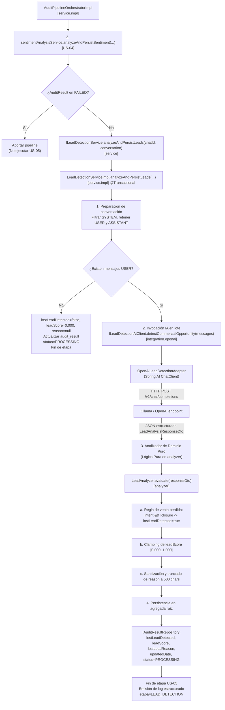

# Design — US-05 Identificar leads no calificados (`aud_detect_leads`)

## 1. Resumen

Esta especificación diseña la tercera etapa del pipeline de análisis de IA de AuditBot AI: la detección de intención comercial o de compra en conversaciones de chatbot, la evaluación de cierre de oportunidades y la identificación de leads no calificados o ventas perdidas (`lost_lead_detected`).

El componente es activado secuencialmente por `AuditPipelineOrchestratorImpl` tras la culminación exitosa del análisis de sentimiento (US-04). Filtra los mensajes de rol `SYSTEM`, preserva los mensajes `USER` y `ASSISTANT` en orden cronológico e invoca un adaptador de integración (`OpenAiLeadDetectionAdapter`) que envía el diálogo completo al endpoint compatible OpenAI / Ollama (`/v1`) mediante `ChatClient` de Spring AI con structured output JSON.

La respuesta estructurada es procesada por un analizador de dominio puro (`LeadAnalyzer`) libre de dependencias de frameworks, el cual aplica reglas deterministas de negocio para dictaminar si la conversación califica como oportunidad perdida (`lostLeadDetected = commercialIntentDetected && !closureAchieved`), acota el `leadScore` en el rango `[0.000, 1.000]` y sanea el motivo descriptivo (`lostLeadReason`).

Finalmente, el servicio transaccional (`LeadDetectionServiceImpl`) persiste atómicamente `lost_lead_detected`, `lead_score`, `lost_lead_reason` y `updated_date` en la tabla `audit_result`, manteniendo el estado en `PROCESSING` para la siguiente etapa de recomendaciones (US-06).

---

## 2. Diagrama de flujo y arquitectura por capas



### Frontera de cada capa

| Capa | Paquete | Qué PUEDE hacer | Qué NO PUEDE hacer |
|---|---|---|---|
| **Integración OpenAI** | `api.integration.openai` | Usar Spring AI (`ChatClient`, `ChatClient.Builder`), configurar prompts comerciales, invocar endpoint `/v1`, deserializar a `LeadAnalysisResponseDto`. | Importar entidades JPA, repositorios, o contener lógica de umbrales y reglas de negocio. |
| **Analizador Puro** | `api.analyzer` | Lógica pura de validación, clamping de scores, reglas booleanas de lead perdido y truncado de texto. | Depender de Spring (`@Component`, etc.), Spring AI, JPA, Jackson o AMQP. |
| **Servicio de Aplicación** | `api.service`, `api.service.impl` | Orquestar flujo, invocar IA y analizador, gestionar transacciones (`@Transactional`), manejar errores de IA marcando `FAILED`. | Contener lógica de análisis léxico o prompts de LLM directamente. |
| **Repositorio / Modelo** | `api.repository`, `api.model` | Mapeo relacional JPA de `AuditResult`, migración Flyway `V4`, consultas Spring Data JPA. | Depender de Spring AI o capas superiores. |

---

## 3. Modelo de datos y migración Flyway

### Script Flyway: `src/main/resources/db/migration/V4__add_lost_lead_reason.sql`

```sql
-- V4__add_lost_lead_reason.sql
-- Agregar motivo de oportunidad de venta perdida en audit_result (US-05)

ALTER TABLE audit_result 
    ADD COLUMN lost_lead_reason VARCHAR(500) NULL AFTER lead_score;
```

### Entidad `AuditResult`

Se actualiza `ec.com.technoloqie.auditbot.api.model.AuditResult`:

```java
    /** Escribe US-05. Rango 0.000 – 1.000. */
    @Column(name = "lead_score", precision = 4, scale = 3)
    private BigDecimal leadScore;

    /** Escribe US-05. Motivo explicativo de la oportunidad de venta perdida. */
    @Column(name = "lost_lead_reason", length = 500)
    private String lostLeadReason;
```

---

## 4. Clases, DTOs e Interfaces

### 4.1 DTOs (`ec.com.technoloqie.auditbot.api.dto`)

1. **`LeadAnalysisResponseDto`** (Salida estructurada del modelo de IA):
   ```java
   public record LeadAnalysisResponseDto(
       Boolean commercialIntentDetected,
       BigDecimal leadScore,
       Boolean closureAchieved,
       String reason
   ) {}
   ```

2. **`LeadEvaluationResultDto`** (Resultado evaluado por el analizador puro):
   ```java
   public record LeadEvaluationResultDto(
       boolean lostLeadDetected,
       BigDecimal leadScore,
       String lostLeadReason
   ) {}
   ```

### 4.2 Analizador Puro (`ec.com.technoloqie.auditbot.api.analyzer.LeadAnalyzer`)

Clase POJO libre de dependencias de Spring:

```java
public class LeadAnalyzer {

    public LeadEvaluationResultDto evaluate(LeadAnalysisResponseDto aiResponse) {
        if (aiResponse == null) {
            return new LeadEvaluationResultDto(false, BigDecimal.ZERO.setScale(3), null);
        }

        boolean commercialIntent = Boolean.TRUE.equals(aiResponse.commercialIntentDetected());
        boolean closure = Boolean.TRUE.equals(aiResponse.closureAchieved());

        if (!commercialIntent) {
            return new LeadEvaluationResultDto(false, BigDecimal.ZERO.setScale(3), null);
        }

        BigDecimal clampedScore = clampScore(aiResponse.leadScore());

        if (closure) {
            return new LeadEvaluationResultDto(false, clampedScore, null);
        }

        String sanitizedReason = sanitizeReason(aiResponse.reason());
        return new LeadEvaluationResultDto(true, clampedScore, sanitizedReason);
    }

    private BigDecimal clampScore(BigDecimal rawScore) {
        if (rawScore == null) {
            return BigDecimal.ZERO.setScale(3);
        }
        if (rawScore.compareTo(BigDecimal.ZERO) < 0) {
            return BigDecimal.ZERO.setScale(3);
        }
        if (rawScore.compareTo(BigDecimal.ONE) > 0) {
            return BigDecimal.ONE.setScale(3);
        }
        return rawScore.setScale(3, RoundingMode.HALF_UP);
    }

    private String sanitizeReason(String reason) {
        if (reason == null || reason.isBlank()) {
            return "Oportunidad de venta no concretada sin cierre registrado";
        }
        String trimmed = reason.trim();
        return trimmed.length() > 500 ? trimmed.substring(0, 500) : trimmed;
    }
}
```

### 4.3 Puerto y Adaptador de IA (`ec.com.technoloqie.auditbot.api.integration.openai`)

1. **Puerto:**
   ```java
   public interface ILeadDetectionAiClient {
       LeadAnalysisResponseDto evaluateCommercialOpportunity(List<AuditMessageDto> conversationMessages);
   }
   ```

2. **Adaptador (`OpenAiLeadDetectionAdapter`):**
   - Inyecta `ChatClient`.
   - Lee propiedad `auditbot.ai.openai.timeout-seconds` (default 30).
   - Confecciona mensaje de sistema y lista de mensajes concatenados en formato diálogo.
   - Utiliza `entity(LeadAnalysisResponseDto.class)` de Spring AI.
   - En caso de timeout o error HTTP/parsing, propaga `AiProcessingException` (o excepción runtime controlada).

### 4.4 Servicio de Aplicación (`ec.com.technoloqie.auditbot.api.service`)

1. **Interfaz:**
   ```java
   public interface ILeadDetectionService {
       void analyzeAndPersistLeads(String chatId, AuditConversationDto conversation);
   }
   ```

2. **Implementación (`LeadDetectionServiceImpl`):**
   - Inyecta `ILeadDetectionAiClient`, `LeadAnalyzer`, `IAuditResultRepository`.
   - Anotada con `@Service` y `@Transactional`.
   - Busca `AuditResult` por `chatId`. Si no existe o `status == FAILED`, retorna.
   - Filtra mensajes `SYSTEM`. Si no hay mensajes `USER`, persiste valores neutros (`false`, `0.000`, `null`).
   - Envía a `ILeadDetectionAiClient`.
   - Pasa respuesta por `LeadAnalyzer`.
   - Actualiza `lostLeadDetected`, `leadScore`, `lostLeadReason`, `updatedDate` en `AuditResult`.
   - Captura excepciones del cliente de IA: marca `AuditResult` en `status = FAILED`, `errorMessage = "[AI_ERROR] " + ex.getMessage()`.

### 4.5 Orquestador (`AuditPipelineOrchestratorImpl`)

Inyecta `ILeadDetectionService`:
```java
// 1. Gaps (US-03)
knowledgeGapService.analyzeAndPersistGaps(chatId, conversation);
if (hasFailed(chatId)) return;

// 2. Sentimiento (US-04)
sentimentAnalysisService.analyzeAndPersistSentiment(chatId, conversation);
if (hasFailed(chatId)) return;

// 3. Leads (US-05)
leadDetectionService.analyzeAndPersistLeads(chatId, conversation);
```

---

## 5. Manejo de errores y resiliencia

1. **Fallo en LLM / Timeout / Servicio Caído:**
   - Si la llamada HTTP al endpoint de Ollama/OpenAI falla o sobrepasa el timeout, la excepción es atrapada en `LeadDetectionServiceImpl`.
   - Se actualiza `AuditResult` con `status = AuditStatus.FAILED` y `errorMessage` truncado a 500 caracteres prefijado con `[AI_ERROR]`.
   - No se lanza excepción no controlada hacia arriba, previniendo loops infinitos en AMQP y permitiendo trazabilidad clara en la base de datos.
2. **Entrada sin mensajes de usuario:**
   - Conversaciones vacías o únicamente con mensajes automáticos de sistema no se envían a la IA para ahorrar cuota/latencia, registrándose deterministamente con `lostLeadDetected = false`, `leadScore = 0.000` y `status = PROCESSING`.
3. **Idempotencia:**
   - La actualización se realiza sobre la entidad aggregate root `AuditResult`, sobreescribiendo valores si la auditoría se reintenta.

---

## 6. Alternativas descartadas

1. **Crear una tabla hija `audit_lead`:**
   - *Alternativa descartada:* Crear una tabla relacional independiente `audit_lead` con foreign key a `audit_result`.
   - *Razón de descarte:* Según `docs/data-model.md` y `V1__create_audit_result.sql`, las columnas `lost_lead_detected` y `lead_score` ya forman parte intrínseca de `audit_result` (no existe una relación 1:N de leads como sí ocurre con mensajes de sentimiento o brechas individuales). La evaluación de lead es a nivel agregado de conversación, por lo que agregar simplemente la columna `lost_lead_reason` en `audit_result` mediante `V4` es más simple, consistente con el modelo y de menor sobrecarga transaccional.
2. **Evaluación de intención comercial mensaje a mensaje:**
   - *Alternativa descartada:* Evaluar cada turno o mensaje de usuario por separado para detectar intención comercial y luego agregar los resultados.
   - *Razón de descarte:* Determinar si una oportunidad se cerró (conversión o derivación) requiere entender el desenlace del diálogo completo. Evaluar mensaje por mensaje incrementaría $N$ veces las llamadas a la IA y no capturaría adecuadamente el contexto global de si el chatbot asistió o perdió la venta al final del diálogo.
