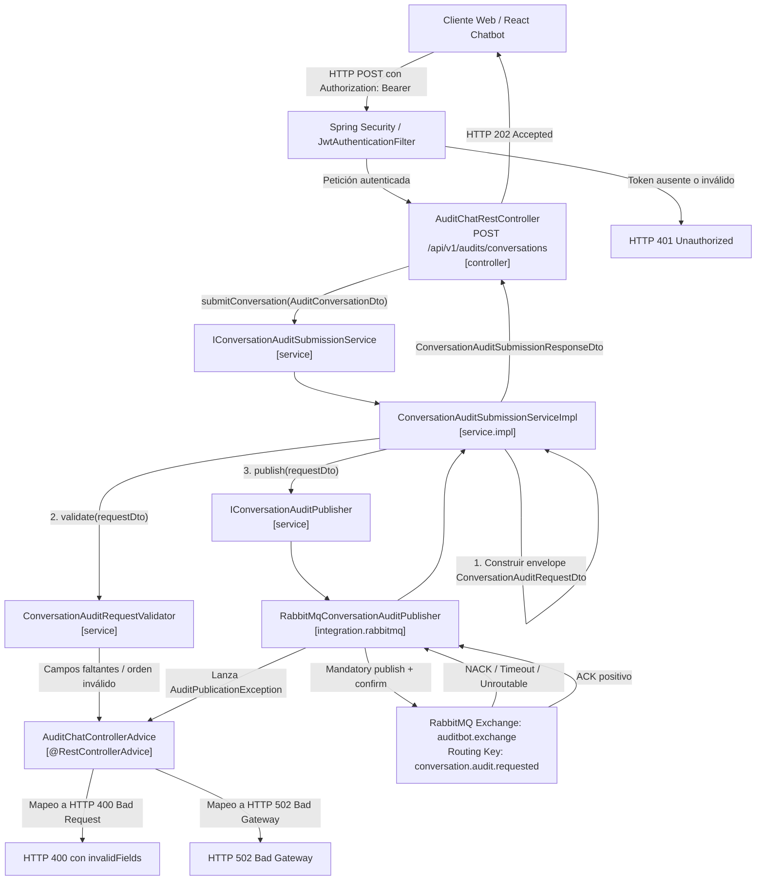

# Design — US-06 Publicación de Auditoría de Chat vía REST (`pub_aud_msg`)

## 1. Resumen

Esta especificación diseña el canal seguro de recepción vía API REST para la auditoría de conversaciones en `tec-auditbot-ws`. El endpoint `POST /api/v1/audits/conversations` actúa como Ingestion Gateway / BFF para clientes web (React) y sistemas integradores, eliminando la necesidad de exponer credenciales o conexiones de RabbitMQ en el navegador.

El flujo procesa peticiones HTTP autenticadas con token Bearer JWT, valida la integridad de la conversación contra las reglas de contrato `1.0` de US-01, construye el envelope `ConversationAuditRequestDto` y delega la publicación al puerto existente `IConversationAuditPublisher`. Si RabbitMQ confirma positivamente el mensaje, el controlador retorna `HTTP 202 Accepted` junto con los metadatos de admisión. Ante payloads inválidos, tokens erróneos o fallos del broker, el sistema retorna respuestas HTTP estandarizadas y controladas (`400 Bad Request`, `401 Unauthorized`, `502 Bad Gateway`) protegiendo en todo momento la privacidad de los mensajes y la estabilidad del chatbot.

---

## 2. Diagrama de flujo y arquitectura por capas



### Frontera de cada capa

| Capa | Paquete | Qué PUEDE hacer | Qué NO PUEDE hacer |
|---|---|---|---|
| **Seguridad** | `api.config` | Configurar `SecurityFilterChain`, CORS, deshabilitar CSRF, validar tokens Bearer JWT y establecer `SecurityContext`. | Contener lógica de auditoría o interactuar con repositorios. |
| **Controlador REST** | `api.controller` | Recibir la petición HTTP, invocar `IConversationAuditSubmissionService`, retornar `ResponseEntity` (`202 Accepted`). | Importar RabbitMQ, Spring AMQP, o contener lógica de negocio/validaciones manuales. |
| **Manejador de Errores** | `api.controller.advice` | Capturar excepciones de validación y publicación, mapear a códigos HTTP (`400`, `502`, `500`), retornar DTO de error. | Filtrar datos sensibles (PII) o trazas internas en el cuerpo de error. |
| **Servicio de Aplicación** | `api.service`, `api.service.impl` | Generar `eventId`, armar envelope `ConversationAuditRequestDto`, invocar validador, delegar en `IConversationAuditPublisher`. | Conocer detalles HTTP (HttpServletRequest, ResponseEntity) o clases del broker AMQP. |
| **Adaptador AMQP** | `api.integration.rabbitmq` | Serializar JSON, enviar mensaje a exchange `auditbot.exchange`, esperar publisher confirm. | Ser llamado directamente desde el controlador. |

---

## 3. Decisiones técnicas y alternativas descartadas

### Decisión 1: Retorno HTTP 202 Accepted frente a HTTP 200 OK
- **Elección:** Retornar `HTTP 202 Accepted` en la respuesta exitosa.
- **Justificación:** El estándar HTTP RFC 9110 define `202 Accepted` específicamente para solicitudes que han sido aceptadas para procesamiento asíncrono pero cuya ejecución (los analyzers de IA y la persistencia en `audit_result`) no ha concluido. Esto comunica claramente al cliente que la auditoría está encolada.
- **Alternativa descartada:** `HTTP 200 OK`. Aunque funcional, puede dar a entender al cliente que el análisis completo de la conversación ya finalizó en tiempo síncrono.

### Decisión 2: Reutilización directa de `IConversationAuditPublisher` mediada por un servicio
- **Elección:** Crear la interfaz de servicio `IConversationAuditSubmissionService` que orquesta la construcción del DTO de evento y delega en el puerto `IConversationAuditPublisher`.
- **Justificación:** Mantiene la regla estricta de arquitectura por capas (Controller → Service → Adapter). El controlador no se acopla a las especificidades del puerto de infraestructura de publicación ni a los tipos AMQP.
- **Alternativa descartada:** Inyectar directamente `IConversationAuditPublisher` en el controlador. Descartada porque violaría la separación de capas y acoplaría el controller con la responsabilidad de ensamblar identificadores UUID, timestamps de eventos y schemas.

### Decisión 3: Validación del Token Bearer JWT Stateless
- **Elección:** Filtro liviano de seguridad en Spring Security que extrae la cabecera `Authorization: Bearer <token>`, valida el token (expiración y clave secreta HMAC) y autentica el contexto. Para entornos locales/desarrollo se provee una clave por defecto configurable vía `ec.com.technoloqie.auditbot.security.jwt.secret`.
- **Justificación:** El cliente frontend sólo requiere enviar un token JWT ya obtenido en su sesión de chat. El backend valida el token de forma stateless sin llamadas externas de red a un servidor OAuth2 ni sesiones HTTP en memoria.
- **Alternativa descartada:** Autenticación básica HTTP o credenciales de RabbitMQ en cabeceras. Descartada por ser insegura e implicar exposición de secretos del servidor.

### Decisión 4: Mapeo de errores de broker a HTTP 502 Bad Gateway
- **Elección:** Capturar `AuditPublicationException` en `@RestControllerAdvice` y mapearlo a `HTTP 502 Bad Gateway`.
- **Justificación:** RabbitMQ actúa como un servicio aguas abajo (upstream broker). Si el broker rechaza la publicación o está caído, el fallo reside en la pasarela o intermediario hacia el almacenamiento asíncrono, lo que corresponde formalmente a `502 Bad Gateway`.
- **Alternativa descartada:** Devolver `HTTP 500 Internal Server Error`. Descartada porque confunde un fallo interno de código de la aplicación con la indisponibilidad de la infraestructura de mensajería.

---

## 4. Componentes, contratos y DTOs

### 4.1 DTOs (`ec.com.technoloqie.auditbot.api.dto`)

#### `ConversationAuditSubmissionResponseDto` (Record)
```java
package ec.com.technoloqie.auditbot.api.dto;

import java.time.Instant;
import java.util.UUID;

/**
 * Respuesta devuelta al cliente tras admitir exitosamente una conversación para auditoría.
 */
public record ConversationAuditSubmissionResponseDto(
        UUID eventId,
        String chatId,
        String status,
        String message,
        Instant submittedAt) {
}
```

#### `ApiErrorResponseDto` (Record)
```java
package ec.com.technoloqie.auditbot.api.dto;

import java.time.Instant;
import java.util.List;

/**
 * Estructura estandarizada de respuesta para errores de la API.
 */
public record ApiErrorResponseDto(
        Instant timestamp,
        int status,
        String error,
        String message,
        List<String> invalidFields) {

    public ApiErrorResponseDto(Instant timestamp, int status, String error, String message) {
        this(timestamp, status, error, message, List.of());
    }
}
```

### 4.2 Servicio de Aplicación (`ec.com.technoloqie.auditbot.api.service`)

#### Puerto: `IConversationAuditSubmissionService`
```java
package ec.com.technoloqie.auditbot.api.service;

import ec.com.technoloqie.auditbot.api.dto.AuditConversationDto;
import ec.com.technoloqie.auditbot.api.dto.ConversationAuditSubmissionResponseDto;

public interface IConversationAuditSubmissionService {

    /**
     * Valida la conversación, ensambla el evento de auditoría y lo publica en RabbitMQ.
     *
     * @param conversation payload de la conversación
     * @return confirmación de la admisión
     */
    ConversationAuditSubmissionResponseDto submitConversation(AuditConversationDto conversation);
}
```

#### Implementación: `ConversationAuditSubmissionServiceImpl`
```java
package ec.com.technoloqie.auditbot.api.service.impl;

@Service
@Slf4j
public class ConversationAuditSubmissionServiceImpl implements IConversationAuditSubmissionService {

    private final IConversationAuditPublisher publisher;
    private final ConversationAuditRequestValidator validator;
    private final Clock clock;
    private final String producer;

    public ConversationAuditSubmissionServiceImpl(
            IConversationAuditPublisher publisher,
            ConversationAuditRequestValidator validator,
            Clock clock,
            @Value("${auditbot.messaging.producer:smart-chatbot-rest}") String producer) {
        this.publisher = publisher;
        this.validator = validator;
        this.clock = clock;
        this.producer = producer;
    }

    @Override
    public ConversationAuditSubmissionResponseDto submitConversation(AuditConversationDto conversation) {
        UUID eventId = UUID.randomUUID();
        Instant now = clock.instant();

        ConversationAuditRequestDto request = new ConversationAuditRequestDto(
                eventId,
                "1.0",
                now,
                producer,
                conversation
        );

        validator.validate(request);
        publisher.publish(request);

        log.info("etapa=REST_AUDIT_SUBMISSION chatId={} eventId={} status=OK",
                conversation != null ? conversation.chatId() : "null", eventId);

        return new ConversationAuditSubmissionResponseDto(
                eventId,
                conversation.chatId(),
                "ACCEPTED",
                "Solicitud de auditoría recibida y enviada a procesamiento asíncrono",
                now
        );
    }
}
```

### 4.3 Controlador REST y Manejador de Errores

#### `AuditChatRestController`
```java
@CrossOrigin(origins = "${ec.com.technoloqie.chatbot.app.url}")
@RestController
@RequestMapping("${ec.com.technoloqie.auditbot.api.prefix}/audits")
@Slf4j
public class AuditChatRestController {

    private final IConversationAuditSubmissionService submissionService;

    public AuditChatRestController(IConversationAuditSubmissionService submissionService) {
        this.submissionService = submissionService;
    }

    @PostMapping("/conversations")
    public ResponseEntity<ConversationAuditSubmissionResponseDto> submitConversation(
            @RequestBody AuditConversationDto conversation) {
        ConversationAuditSubmissionResponseDto response = submissionService.submitConversation(conversation);
        return ResponseEntity.status(HttpStatus.ACCEPTED).body(response);
    }
}
```

#### `AuditChatControllerAdvice` (`ec.com.technoloqie.auditbot.api.controller.advice`)
```java
@RestControllerAdvice
@Slf4j
public class AuditChatControllerAdvice {

    private final Clock clock;

    public AuditChatControllerAdvice(Clock clock) {
        this.clock = clock;
    }

    @ExceptionHandler(InvalidAuditRequestException.class)
    public ResponseEntity<ApiErrorResponseDto> handleInvalidAuditRequest(InvalidAuditRequestException ex) {
        ApiErrorResponseDto error = new ApiErrorResponseDto(
                clock.instant(),
                HttpStatus.BAD_REQUEST.value(),
                HttpStatus.BAD_REQUEST.getReasonPhrase(),
                "La solicitud de conversación no cumple el contrato requerido",
                ex.getInvalidFields()
        );
        return ResponseEntity.status(HttpStatus.BAD_REQUEST).body(error);
    }

    @ExceptionHandler(AuditPublicationException.class)
    public ResponseEntity<ApiErrorResponseDto> handleAuditPublicationException(AuditPublicationException ex) {
        log.error("Fallo de publicación hacia RabbitMQ. eventId={}", ex.getEventId(), ex);
        ApiErrorResponseDto error = new ApiErrorResponseDto(
                clock.instant(),
                HttpStatus.BAD_GATEWAY.value(),
                HttpStatus.BAD_GATEWAY.getReasonPhrase(),
                "Fallo en la publicación asíncrona hacia el broker de mensajería"
        );
        return ResponseEntity.status(HttpStatus.BAD_GATEWAY).body(error);
    }
}
```

### 4.4 Configuración de Seguridad (`ec.com.technoloqie.auditbot.api.config.SecurityConfiguration`)

- Declara bean `SecurityFilterChain`:
  - `csrf(csrf -> csrf.disable())`
  - `cors(cors -> cors.configurationSource(corsConfigurationSource()))`
  - `sessionManagement(session -> session.sessionCreationPolicy(SessionCreationPolicy.STATELESS))`
  - `authorizeHttpRequests`:
    - `POST /api/v1/audits/conversations` $\rightarrow$ `authenticated()`
    - `GET /api/v1/audits` $\rightarrow$ `permitAll()`
    - Cualquier otra ruta $\rightarrow$ `authenticated()`
  - Añade filtro `JwtAuthenticationFilter` antes de `UsernamePasswordAuthenticationFilter`.
  - Configura `AuthenticationEntryPoint` para retornar `401 Unauthorized` ante fallos de autenticación.

---

## 5. Actualización de reglas de arquitectura (`ArchitectureRulesTest`)

En US-01 se tenía:
```java
@Test
void shouldNotExposeAuditRequestHttpEndpoint() {
    ArchRule rule = noClasses()
            .that().resideInAPackage(BASE_PACKAGE + ".controller..")
            .should().dependOnClassesThat().haveFullyQualifiedName(
                    "ec.com.technoloqie.auditbot.api.dto.ConversationAuditRequestDto")
            .orShould().dependOnClassesThat().haveFullyQualifiedName(
                    "ec.com.technoloqie.auditbot.api.service.IConversationAuditPublisher");

    rule.check(importedClasses);
}
```
Con la arquitectura diseñada para US-06:
- El controlador depende de `IConversationAuditSubmissionService` y de `AuditConversationDto`.
- El controlador **NUNCA** depende de `IConversationAuditPublisher` ni de `ConversationAuditRequestDto` ni de tipos de RabbitMQ.
- Por tanto, la regla se renombra y refina a `shouldKeepControllerFreeOfDirectBrokerPublication` para salvaguardar la pureza del controlador garantizando que nunca acceda a adaptadores ni a publicadores AMQP directos.

---

## 6. Propiedades de configuración (`application.properties`)

```properties
# Seguridad JWT
ec.com.technoloqie.auditbot.security.jwt.secret=${JWT_SECRET:AuditBotSecretKeyForJwtTokenValidationMustBeAtLeast256BitsLong!}
auditbot.messaging.producer=${AUDITBOT_PRODUCER:smart-chatbot-rest}
```
