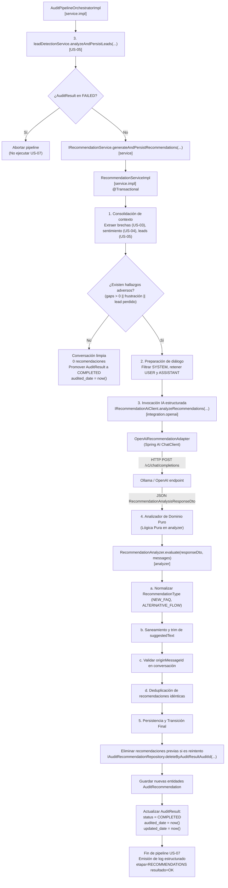
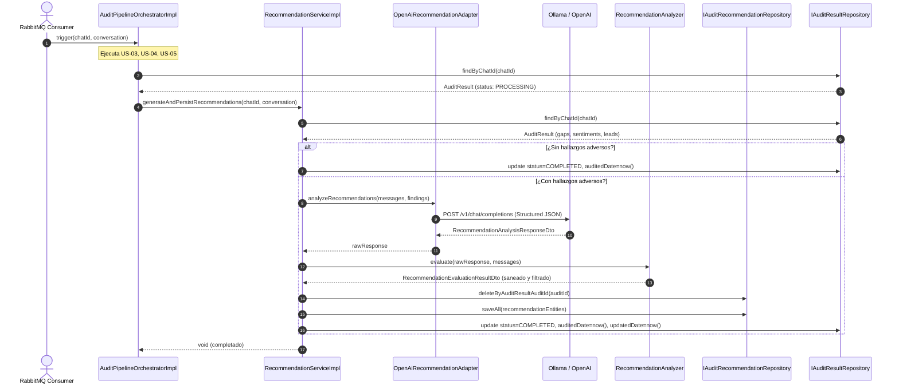

# Design — US-07 Generar recomendaciones de mejora (`aud_automatic_upturn`)

## 1. Resumen

Esta especificación detalla el diseño de la cuarta y última etapa analítica de IA en AuditBot AI: la formulación automática de recomendaciones de mejora (`NEW_FAQ` y `ALTERNATIVE_FLOW`) para la optimización continua de chatbots empresariales, así como la culminación oficial del ciclo de vida de la auditoría (`status = COMPLETED` y registro de `audited_date`).

El componente es disparado secuencialmente por `AuditPipelineOrchestratorImpl` una vez concluida la detección de oportunidades comerciales y leads no calificados (US-05). Recopila los hallazgos analizados de las etapas precedentes (gaps detectados, sentimientos negativos y motivos de leads perdidos), filtra los mensajes del diálogo conversacional, e invoca al modelo de IA mediante `OpenAiRecommendationAdapter` utilizando Spring AI `ChatClient` con formato de salida JSON estructurado.

Un analizador de dominio puro (`RecommendationAnalyzer`) procesa las sugerencias generadas, validando el tipo según el enum `RecommendationType`, saneando y truncando textos, confirmando la validez del `originMessageId` contra los mensajes de la conversación, y eliminando recomendaciones duplicadas.

Posteriormente, el servicio de aplicación (`RecommendationServiceImpl`) persiste transaccionalmente las entidades `AuditRecommendation` en la tabla `audit_recommendation` (manejando idempotencia ante reintentos mediante eliminación previa de registros del mismo `audit_id`), promueve el registro agregado raíz `AuditResult` al estado final `COMPLETED`, y registra la fecha de finalización en `audited_date`.

---

## 2. Diagramas de arquitectura y flujo

### 2.1 Diagrama de flujo del pipeline y orquestación



### 2.2 Diagrama de secuencia de la interacción



---

## 3. Modelo de datos y migración Flyway

### 3.1 Script Flyway: `src/main/resources/db/migration/V5__create_audit_recommendation.sql`

```sql
-- V5__create_audit_recommendation.sql
-- Creación de la tabla de recomendaciones de mejora generadas automáticamente (US-07)

CREATE TABLE audit_recommendation (
    recommendation_id VARCHAR(36)     NOT NULL,
    audit_id          VARCHAR(36)     NOT NULL,
    type              VARCHAR(32)     NOT NULL,
    suggested_text    TEXT            NOT NULL,
    origin_message_id VARCHAR(128)    NULL,
    created_date      DATETIME(6)     NOT NULL,

    CONSTRAINT pk_audit_recommendation PRIMARY KEY (recommendation_id),
    CONSTRAINT fk_audit_recommendation_audit_result 
        FOREIGN KEY (audit_id) REFERENCES audit_result (audit_id) 
        ON DELETE CASCADE
);

CREATE INDEX idx_audit_recommendation_audit_id ON audit_recommendation (audit_id);
```

### 3.2 Diagrama Entidad-Relación de Persistencia

```mermaid
erDiagram
    AUDIT_RESULT ||--o{ AUDIT_GAP : "1:N"
    AUDIT_RESULT ||--o{ AUDIT_SENTIMENT : "1:N"
    AUDIT_RESULT ||--o{ AUDIT_RECOMMENDATION : "1:N"

    AUDIT_RESULT {
        VARCHAR(36) audit_id PK
        VARCHAR(128) chat_id UK
        VARCHAR(128) assistant_id
        VARCHAR(20) status
        VARCHAR(36) event_id
        INT attempt_count
        VARCHAR(500) error_message
        BOOLEAN frustration_detected
        BOOLEAN lost_lead_detected
        DECIMAL(4,3) lead_score
        VARCHAR(500) lost_lead_reason
        INT gaps_count
        DATETIME(6) created_date
        DATETIME(6) updated_date
        DATETIME(6) audited_date
    }

    AUDIT_RECOMMENDATION {
        VARCHAR(36) recommendation_id PK
        VARCHAR(36) audit_id FK
        VARCHAR(32) type
        TEXT suggested_text
        VARCHAR(128) origin_message_id
        DATETIME(6) created_date
    }
```

### 3.3 Entidades y Enums

1. **`RecommendationType`** en `ec.com.technoloqie.auditbot.api.model`:
```java
package ec.com.technoloqie.auditbot.api.model;

public enum RecommendationType {
    NEW_FAQ,
    ALTERNATIVE_FLOW
}
```

2. **`AuditRecommendation`** en `ec.com.technoloqie.auditbot.api.model`:
```java
package ec.com.technoloqie.auditbot.api.model;

import jakarta.persistence.Column;
import jakarta.persistence.Entity;
import jakarta.persistence.EnumType;
import jakarta.persistence.Enumerated;
import jakarta.persistence.FetchType;
import jakarta.persistence.Id;
import jakarta.persistence.JoinColumn;
import jakarta.persistence.ManyToOne;
import jakarta.persistence.Table;
import lombok.Getter;
import lombok.NoArgsConstructor;
import lombok.Setter;

import java.time.Instant;

@Entity
@Table(name = "audit_recommendation")
@Getter
@Setter
@NoArgsConstructor
public class AuditRecommendation {

    @Id
    @Column(name = "recommendation_id", length = 36, nullable = false, updatable = false)
    private String recommendationId;

    @ManyToOne(fetch = FetchType.LAZY, optional = false)
    @JoinColumn(name = "audit_id", nullable = false, updatable = false)
    private AuditResult auditResult;

    @Enumerated(EnumType.STRING)
    @Column(name = "type", length = 32, nullable = false)
    private RecommendationType type;

    @Column(name = "suggested_text", nullable = false, columnDefinition = "TEXT")
    private String suggestedText;

    @Column(name = "origin_message_id", length = 128)
    private String originMessageId;

    @Column(name = "created_date", nullable = false, updatable = false)
    private Instant createdDate;
}
```

3. **Actualización de `AuditResult`**:
```java
    /** Recomendaciones de mejora generadas (US-07). */
    @OneToMany(mappedBy = "auditResult", cascade = CascadeType.ALL, orphanRemoval = true)
    private List<AuditRecommendation> recommendations = new ArrayList<>();
```

---

## 4. Clases, DTOs e Interfaces

### 4.1 DTOs (`ec.com.technoloqie.auditbot.api.dto`)

1. **`AuditFindingsContextDto`** (Contexto de hallazgos previos para alimentar el análisis):
```java
public record AuditFindingsContextDto(
    int gapsCount,
    List<String> gapQuestions,
    boolean frustrationDetected,
    boolean lostLeadDetected,
    BigDecimal leadScore,
    String lostLeadReason
) {}
```

2. **`RecommendationCandidateDto`** (Salida estructurada cruda devuelta por la IA):
```java
public record RecommendationCandidateDto(
    String type,
    String suggestedText,
    String originMessageId
) {}
```

3. **`RecommendationAnalysisResponseDto`** (Contenedor de respuesta de la IA):
```java
public record RecommendationAnalysisResponseDto(
    List<RecommendationCandidateDto> recommendations
) {}
```

4. **`RecommendationItemDto`** (Recomendación procesada y validada por el analizador puro):
```java
public record RecommendationItemDto(
    RecommendationType type,
    String suggestedText,
    String originMessageId
) {}
```

5. **`RecommendationEvaluationResultDto`** (Resultado del analizador puro):
```java
public record RecommendationEvaluationResultDto(
    List<RecommendationItemDto> items
) {}
```

### 4.2 Analizador Puro (`ec.com.technoloqie.auditbot.api.analyzer.RecommendationAnalyzer`)

Clase Java pura sin dependencias de frameworks ni anotaciones Spring:
```java
package ec.com.technoloqie.auditbot.api.analyzer;

import ec.com.technoloqie.auditbot.api.dto.AuditMessageDto;
import ec.com.technoloqie.auditbot.api.dto.RecommendationAnalysisResponseDto;
import ec.com.technoloqie.auditbot.api.dto.RecommendationCandidateDto;
import ec.com.technoloqie.auditbot.api.dto.RecommendationEvaluationResultDto;
import ec.com.technoloqie.auditbot.api.dto.RecommendationItemDto;
import ec.com.technoloqie.auditbot.api.model.RecommendationType;

import java.util.ArrayList;
import java.util.HashSet;
import java.util.List;
import java.util.Set;

public class RecommendationAnalyzer {

    public RecommendationEvaluationResultDto evaluate(
            RecommendationAnalysisResponseDto aiResponse,
            List<AuditMessageDto> conversationMessages) {

        if (aiResponse == null || aiResponse.recommendations() == null || aiResponse.recommendations().isEmpty()) {
            return new RecommendationEvaluationResultDto(List.of());
        }

        Set<String> validMessageIds = extractValidMessageIds(conversationMessages);
        List<RecommendationItemDto> validatedItems = new ArrayList<>();
        Set<String> uniqueKeys = new HashSet<>();

        for (RecommendationCandidateDto candidate : aiResponse.recommendations()) {
            if (candidate == null) {
                continue;
            }

            // 1. Validar texto sugerido
            if (candidate.suggestedText() == null || candidate.suggestedText().isBlank()) {
                continue;
            }
            String sanitizedText = candidate.suggestedText().trim();

            // 2. Normalizar tipo
            RecommendationType parsedType = parseType(candidate.type());
            if (parsedType == null) {
                continue;
            }

            // 3. Validar originMessageId
            String originMsgId = candidate.originMessageId();
            if (originMsgId != null) {
                originMsgId = originMsgId.trim();
                if (originMsgId.isBlank() || !validMessageIds.contains(originMsgId)) {
                    originMsgId = null;
                }
            }

            // 4. Deduplicar por tipo y texto
            String deduplicationKey = parsedType.name() + "::" + sanitizedText.toLowerCase();
            if (uniqueKeys.add(deduplicationKey)) {
                validatedItems.add(new RecommendationItemDto(parsedType, sanitizedText, originMsgId));
            }
        }

        return new RecommendationEvaluationResultDto(validatedItems);
    }

    private RecommendationType parseType(String rawType) {
        if (rawType == null || rawType.isBlank()) {
            return null;
        }
        try {
            return RecommendationType.valueOf(rawType.trim().toUpperCase());
        } catch (IllegalArgumentException ex) {
            return null;
        }
    }

    private Set<String> extractValidMessageIds(List<AuditMessageDto> messages) {
        if (messages == null) {
            return Set.of();
        }
        Set<String> ids = new HashSet<>();
        for (AuditMessageDto msg : messages) {
            if (msg != null && msg.messageId() != null && !msg.messageId().isBlank()) {
                ids.add(msg.messageId().trim());
            }
        }
        return ids;
    }
}
```

### 4.3 Puerto y Adaptador de Integración OpenAI (`integration.openai`)

1. **Puerto:**
```java
package ec.com.technoloqie.auditbot.api.integration.openai;

import ec.com.technoloqie.auditbot.api.dto.AuditFindingsContextDto;
import ec.com.technoloqie.auditbot.api.dto.AuditMessageDto;
import ec.com.technoloqie.auditbot.api.dto.RecommendationAnalysisResponseDto;

import java.util.List;

public interface IRecommendationAiClient {
    RecommendationAnalysisResponseDto analyzeRecommendations(
            List<AuditMessageDto> conversationMessages,
            AuditFindingsContextDto findings);
}
```

2. **Adaptador (`OpenAiRecommendationAdapter`):**
   - Utiliza `ChatClient` de Spring AI.
   - Aplica timeout configurable `auditbot.ai.openai.timeout-seconds` (30s).
   - Genera prompt especializado concatenando los hallazgos previos y los mensajes con rol `USER` y `ASSISTANT`.
   - Utiliza `.entity(RecommendationAnalysisResponseDto.class)` para structured output.
   - Captura fallos de conectividad, timeouts y parsing, convirtiéndolos en excepciones controladas.

### 4.4 Repositorio JPA (`ec.com.technoloqie.auditbot.api.repository`)

```java
package ec.com.technoloqie.auditbot.api.repository;

import ec.com.technoloqie.auditbot.api.model.AuditRecommendation;
import org.springframework.data.jpa.repository.JpaRepository;
import org.springframework.stereotype.Repository;

import java.util.List;

@Repository
public interface IAuditRecommendationRepository extends JpaRepository<AuditRecommendation, String> {
    List<AuditRecommendation> findByAuditResultAuditId(String auditId);
    void deleteByAuditResultAuditId(String auditId);
}
```

### 4.5 Servicio de Aplicación (`ec.com.technoloqie.auditbot.api.service`)

1. **Interfaz:**
```java
package ec.com.technoloqie.auditbot.api.service;

import ec.com.technoloqie.auditbot.api.dto.AuditConversationDto;

public interface IRecommendationService {
    void generateAndPersistRecommendations(String chatId, AuditConversationDto conversation);
}
```

2. **Implementación (`RecommendationServiceImpl`):**
   - Anotada con `@Service` y `@Transactional`.
   - Inyecta: `IAuditResultRepository`, `IAuditRecommendationRepository`, `IRecommendationAiClient`, `RecommendationAnalyzer`.
   - Pasos ejecutados:
     1. Localiza `AuditResult` por `chatId`. Si no existe o `status == FAILED`, retorna inmediatamente con log WARN.
     2. En caso de reintento, ejecuta `auditRecommendationRepository.deleteByAuditResultAuditId(auditResult.getAuditId())`.
     3. Construye `AuditFindingsContextDto` extrayendo datos de `AuditResult` y sus brechas asociadas.
     4. Si no hay hallazgos (`gapsCount == 0`, `!frustrationDetected`, `!lostLeadDetected`), no llama al LLM: promueve a `status = COMPLETED`, `auditedDate = Instant.now()`, `updatedDate = Instant.now()`, guarda y finaliza.
     5. Si hay hallazgos, filtra mensajes `SYSTEM` y llama a `aiClient.analyzeRecommendations(...)`.
     6. Ante fallo de IA: marca `status = FAILED`, `errorMessage = "[AI_ERROR] " + ex.getMessage()` (truncado a 500 chars), `updatedDate = Instant.now()`, guarda y retorna sin propagar excepción.
     7. Pasa la respuesta por `RecommendationAnalyzer.evaluate(...)`.
     8. Convierte cada `RecommendationItemDto` a entidad `AuditRecommendation` (UUID, `auditResult`, `createdDate = Instant.now()`) y guarda con `auditRecommendationRepository.saveAll(...)`.
     9. Actualiza `AuditResult`: `status = AuditStatus.COMPLETED`, `auditedDate = Instant.now()`, `updatedDate = Instant.now()`.
     10. Emite log estructurado con `chatId`, `assistantId`, `recomendacionesGeneradas`, `duracionMs`.

### 4.6 Orquestador (`AuditPipelineOrchestratorImpl`)

Se inyecta `IRecommendationService` y se añade la etapa final:
```java
    // 3. Etapa de detección de leads y oportunidades de venta perdidas (US-05)
    leadDetectionService.analyzeAndPersistLeads(chatId, conversation);

    if (isAuditFailed(chatId)) {
        log.warn("chatId={} en estado FAILED tras detección de leads — omitiendo recomendaciones", chatId);
        return;
    }

    // 4. Etapa de generación de recomendaciones de mejora y culminación de auditoría (US-07)
    recommendationService.generateAndPersistRecommendations(chatId, conversation);
```

---

## 5. Manejo de errores y resiliencia

1. **Aislamiento de fallos de IA:** Fallos en el LLM marcan `status = FAILED` con prefijo `[AI_ERROR]` y no interrumpen el listener RabbitMQ, evitando loops de reentrega infinita.
2. **Idempotencia de reintentos:** `deleteByAuditResultAuditId` asegura que reprocesar una conversación limpie recomendaciones anteriores y persista un estado coherente.
3. **Conversaciones limpias sin costo:** Conversaciones sin gaps, frustración ni leads perdidos no realizan llamadas a la IA, ahorrando cuota y latencia.

---

## 6. Alternativas descartadas

1. **Generar recomendaciones en tiempo real en cada etapa previa:**
   - *Descartada:* Invocar a la IA para recomendar durante US-03, luego en US-04 y luego en US-05.
   - *Razón de descarte:* Provocaría múltiples llamadas al LLM con visión fragmentada. Una recomendación integral (`NEW_FAQ` o `ALTERNATIVE_FLOW`) requiere ponderar en conjunto las preguntas no respondidas junto con el sentimiento y el desenlace comercial.
2. **Mantener el estado `PROCESSING` y delegar el estado `COMPLETED` a un endpoint REST posterior:**
   - *Descartada:* Dejar `AuditResult` en `PROCESSING` hasta que el dashboard REST consulte el resultado.
   - *Razón de descarte:* Violaría la semántica del pipeline de procesamiento asíncrono. Cuando el análisis analítico culmina (US-07), el estado legítimo del recurso es `COMPLETED`. Las historias US-08 y US-09 son de consulta de lectura (`GET`).
